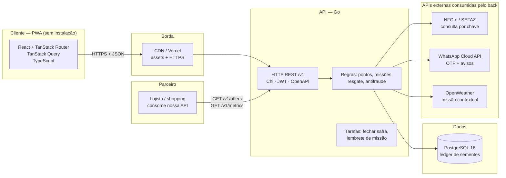
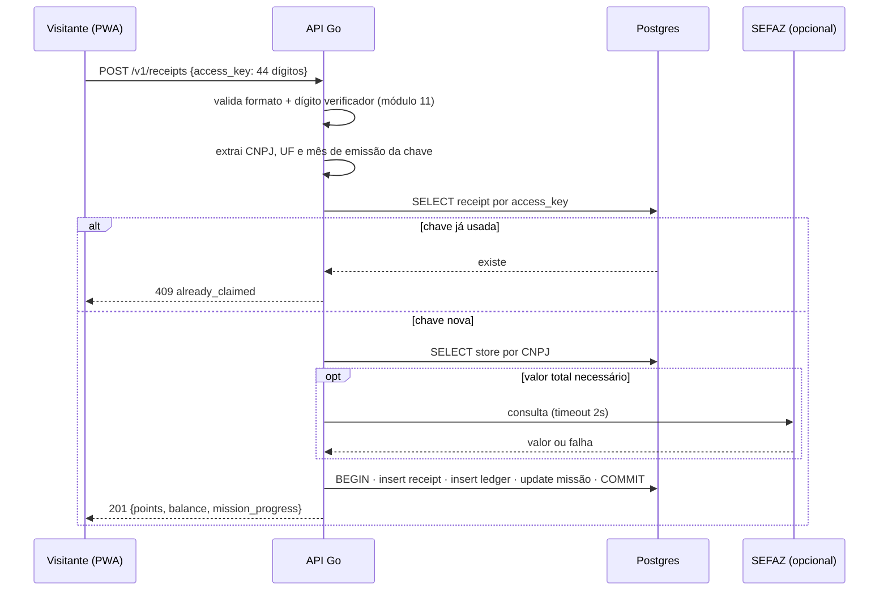

# Entrega 1 — Planejamento técnico inicial

**Projeto:** Raiz — o clube de quem cria raiz no Capim
**Evento:** HackaRun 2026 · UniCatólica · 11–14/11/2026
**Desafio:** 05 — Engajamento e fidelização dos visitantes
**Parceiro:** Capim Dourado Shopping (Palmas-TO)
**Entrega:** 13/11/2026, até 12h
**Item sorteado:** Frontend e desenvolvimento — **Consumo de APIs** (a interface deve buscar dados de uma API)

---

## 0. Resumo em um minuto

O shopping sabe quantas pessoas passaram no mês. Não sabe **quem voltou**. Sem identidade persistente não existe relação — só visitas soltas.

**Raiz** é um PWA (sem instalação) onde cada compra vira vínculo: o visitante escaneia o QR Code da NFC-e que já está no cupom dele, acumula *sementes* e desbloqueia missões entre lojas diferentes. O shopping passa a saber quem é o visitante recorrente, em quais lojas ele compra e quem parou de vir — sem tocar em um único PDV.

- **Para o visitante:** a compra que ele já fez vale algo depois.
- **Para o lojista:** tráfego qualificado e mensurável, sem desconto que corrói margem.
- **Para o shopping:** a métrica que ele nunca teve — recorrência identificada.

**Stack:** React + TypeScript (TanStack Router/Query) · Go · PostgreSQL.
**Sorteio:** consumo de APIs em três camadas — a UI consome nossa API REST tipada, o back consome APIs públicas (NFC-e, WhatsApp Cloud, clima) e expomos uma API para o lojista.

---

## 1. O problema

### 1.1 A tese: o shopping mede passagem, não pessoa

| O que o shopping mede hoje | O que isso responde | O que não responde |
|---|---|---|
| Contadores infravermelhos | Quantas passagens no mês | Se o visitante de hoje é o da terça passada |
| Wi-Fi / captive portal | Taxa de captura (3–8%) | Quem é a pessoa (MAC randomizado, opt-in baixo) |
| Câmeras com visão computacional | Dwell time, heatmap | Quem voltou, quando e depois de quanto tempo |
| Pesquisa trimestral | Percepção e NPS | Comportamento real, por coorte |
| Cupom fiscal / PDV | Venda agregada da loja | 80–90% das notas sem CPF; lojista não compartilha |

Resultado: **o shopping conhece o fluxo do mês, não a visita do mês.** Não sabe LTV, frequência individual, cross-shopping entre lojas, nem quem está há 90 dias sem aparecer. Sem isso, não há segmentação, reativação, campanha por coorte — e não há como provar ao lojista que a ação gerou tráfego incremental em vez de só mídia.

O objetivo do desafio ("vínculo contínuo") é exatamente esse buraco. A solução precisa criar **identidade** antes de criar **recompensa**.

### 1.2 Por que não fazer check-in + pontos + prêmios

É a resposta óbvia, e é a mais fraca:

- **Check-in é declaração, não comportamento.** Qualquer pessoa clica em "estou aqui" de casa. A banca desmonta em 10 segundos.
- **Recompensa genérica não retém.** 19 programas de fidelidade por consumidor no Brasil; só ~35% dos membros resgatam algo no ano; programas baseados em "junte 10 mil pontos" morrem no meio do caminho (Dotz operou anos no prejuízo e pivotou).
- **App de shopping tem o pior cenário de retenção possível:** uso de 1 a 3 vezes por mês contra mediana de retenção D30 de 4% em apps.
- **Não gera dado.** Sem transação associada a uma pessoa, o "engajamento" é uma métrica de vaidade que o shopping não consegue defender internamente.

**Decisão:** o mecanismo de entrada tem que ser um comportamento que o visitante **já tem** e que carrega dado real. Esse comportamento é o cupom fiscal.

### 1.3 Por que a NFC-e é o atalho

O QR Code da NFC-e é obrigatório no varejo brasileiro e já está impresso no cupom que o visitante recebe. A **chave de acesso** (44 dígitos) contém UF, mês/ano de emissão, **CNPJ do estabelecimento**, modelo, série, número e dígito verificador.

Isso nos dá, sem integração com PDV e **sem chamada externa obrigatória**:

1. **Identidade da visita** — um cupom é uma visita com hora e loja.
2. **A loja** — CNPJ mapeado para o cadastro do shopping.
3. **Autenticidade mínima** — validação do dígito verificador (módulo 11), unicidade pela chave, teto diário.
4. **Enriquecimento opcional** — consulta ao portal da SEFAZ para obter o valor total, quando disponível.

O lojista não treina ninguém, não instala nada, não muda o caixa. É a única forma de dado transacional por loja que um shopping regional consegue no dia 1.

---

## 2. A solução: Raiz

### 2.1 Nome e metáfora

**Raiz** — "quem volta, cria raiz". A metáfora é local (Capim Dourado, cerrado) e adulta: não é moedinha, não é mascote, não é "subiu de nível".

| Elemento | Nome | O que é |
|---|---|---|
| Moeda | **Semente** | Pontos ganhos por cupom, missão e retorno |
| Níveis | **Semente → Raiz → Dourado** | Status por sementes nos últimos 12 meses |
| Temporadas | **Safra** | Ciclo de 8 semanas com missões e ranking |
| Sequência | **Ritmo** | Semanas seguidas com visita (bônus, nunca punição) |

### 2.2 O loop

```
        ┌──────────────────────────────────────────────┐
        │  1. Compra em qualquer loja do shopping      │
        │     (comportamento que já existe)            │
        └───────────────────┬──────────────────────────┘
                            ▼
        ┌──────────────────────────────────────────────┐
        │  2. Escaneia o QR da NFC-e (5 segundos)      │
        │     → sementes + loja registrada             │
        └───────────────────┬──────────────────────────┘
                            ▼
        ┌──────────────────────────────────────────────┐
        │  3. Missão avança ("3 lojas diferentes")     │
        │     → o shopping ganha cross-shopping        │
        └───────────────────┬──────────────────────────┘
                            ▼
        ┌──────────────────────────────────────────────┐
        │  4. Resgate imediato (café, estacionamento)  │
        │     → recompensa na MESMA visita             │
        └───────────────────┬──────────────────────────┘
                            ▼
        ┌──────────────────────────────────────────────┐
        │  5. Motivo para voltar em 7 dias             │
        │     (missão em 2/3, safra, evento, ritmo)    │
        └───────────────────┬──────────────────────────┘
                            └──────────► volta ao passo 1
```

O detalhe que segura o loop: **recompensa resgatável na mesma visita**. Programa que promete retorno distante ("junte 10 mil pontos") perde o visitante no caminho.

### 2.3 Mecânicas

| Mecânica | Regra | Por que |
|---|---|---|
| **Cupom** | 10 sementes + 1 por real gasto (quando o valor é lido) | Base previsível e justa |
| **Missão de loja** | Visitar 3 CNPJs diferentes em 7 dias → +150 | Gera cross-shopping, o KPI que o lojista respeita |
| **Missão de categoria** | "Compre em alimentação e em moda na mesma semana" → +100 | Diversifica o mix, reduz dependência de âncora |
| **Ritmo** | 4 semanas seguidas com ao menos 1 cupom → +200 | Recorrência sem chantagem: quebrar reseta o multiplicador, nunca tira sementes |
| **Safra** | Ranking de 8 semanas; top 10 ganha experiência (camarote de evento, valet) | Status e pertencimento, não desconto |
| **Nível** | Raiz a partir de 500 sementes/12m; Dourado a partir de 2.000 | Reconhecimento do frequentador (fila preferencial, pré-venda) |
| **Indicação** | Traga alguém que valide o 1º cupom → +100 para os dois | Aquisição com custo zero e vínculo social |

Três decisões de tom, vindas da pesquisa com o público: **nada de emoji, mascote ou "parabéns, você subiu de nível"**; **nada de punir falta**; **recompensa sempre com nome de coisa real** ("café na Casa do Pão", "2h de estacionamento"), nunca "moedinha".

### 2.4 O que o Raiz não é

- Não é cashback em reais (custo real, margem do lojista, regulação).
- Não é cartão fidelidade físico.
- Não é app nativo (instalação mata a adoção: 2–4% sem incentivo).
- Não é cupom de desconto (treina o cliente a esperar promoção e corrói a margem do lojista).
- Não é chatbot do shopping.

---

## 3. Personas e jornada

Construídas a partir de dados públicos de Palmas-TO (IBGE Censo 2022: ~302 mil hab.) e padrões de consumo. Números marcados como *estimativa* precisam de validação no piloto.

| | **Juliana, 31** | **Lucas, 22** | **Rafael, 38** |
|---|---|---|---|
| Perfil | Analista administrativa, mãe de um filho de 4 | Universitário (UniCatólica), divide apartamento | Advogado autônomo |
| Renda | ~R$ 4.500 domiciliar | ~R$ 1.200 | R$ 9–14 mil |
| Deslocamento | Carro, 12–18 min, Plano Sul | Ônibus/carona, 20–30 min, Plano Norte | Carro, meio da semana |
| Frequência | 2–3×/mês, sábado à tarde | 1×/mês, em grupo | 5–6×/mês, 40–70 min |
| Vai porque | Almoço + playground + uma compra | Cinema, lanche, "lugar seguro pra encontrar a galera" | Banco, Correios, almoço, farmácia |
| Não volta porque | Estacionamento cheio, fila, "só gastar" | Preço do cinema, nada grátis pra fazer | Estacionamento pago, Wi-Fi ruim, fila |
| **Gatilho de 7 dias** | Sobremesa grátis válida só no próximo sábado | Ingresso com desconto para 3+ confirmado até quinta | 1h de estacionamento grátis + retirada sem fila |

**Onde a relação morre hoje:** depois da visita. Não há nenhum contato até a próxima, o visitante não sabe quanto gastou nem o que ganhou, e esquece que existe programa. É exatamente esse intervalo que o Raiz ocupa.

**Barreiras de adoção que o produto assume:** "adicionar à tela inicial" é incompreendido (por isso o acesso principal é um link no WhatsApp, não um app); Wi-Fi do shopping satura no pico (o fluxo tem que funcionar em 4G ruim); desconfiança de cadastro (pedimos **só nome e telefone**); WhatsApp é o canal real.

---

## 4. Estrutura inicial das telas

PWA mobile-first, 7 telas. Navegação por barra inferior de 4 itens (Início · Missões · Carteira · Perfil) e o botão de escanear sempre visível.

### 4.1 Mapa de navegação

```
                     ┌──────────────┐
                     │  1. Entrada  │  telefone → código → consentimento
                     └──────┬───────┘
                            ▼
   ┌────────────────────────────────────────────────────────┐
   │  2. Início ("Hoje no Capim")                            │
   │     saldo · próximo passo · ofertas · evento            │
   └───┬──────────────┬──────────────┬──────────────┬───────┘
       ▼              ▼              ▼              ▼
 ┌──────────┐  ┌────────────┐  ┌──────────┐  ┌──────────┐
 │ 3. Scan  │  │ 5. Missões │  │6. Prêmios│  │ 7. Perfil │
 │  cupom   │  │  + Safra   │  │ catálogo │  │  + LGPD   │
 └────┬─────┘  └─────┬──────┘  └────┬─────┘  └──────────┘
      │              │              │
      ▼              │              ▼
 ┌──────────┐        │        ┌──────────────┐
 │4. Carteira│◄──────┘        │ Voucher + QR │
 │  extrato  │               │  (balcão)    │
 └──────────┘               └──────────────┘
```

### 4.2 Tela 1 — Entrada

Duas etapas em uma tela, sem senha. Telefone → código de 6 dígitos → consentimento com uma frase clara e o que é coletado.

```
┌───────────────────────────────┐
│                               │
│  RAIZ                         │
│  Quem volta, cria raiz.       │
│                               │
│  Seu telefone                 │
│  ┌─────────────────────────┐  │
│  │ (63) 9 9999-9999        │  │
│  └─────────────────────────┘  │
│                               │
│  [ Receber código no zap ]    │
│                               │
│  Sem senha. Sem app.          │
│  Guardamos seu telefone e os  │
│  cupons que você escanear.    │
│  Você pode apagar tudo.       │
└───────────────────────────────┘
```

- **Critério de aceite:** código válido cria sessão em < 3s; telefone inválido mostra erro inline; consentimento é registrado com data/hora.
- **Demo:** código fixo `000000` no ambiente de demonstração (marcado como tal na tela), para não depender de entrega de WhatsApp no palco.

### 4.3 Tela 2 — Início ("Hoje no Capim")

Uma única chamada (`GET /v1/home`) alimenta a tela inteira.

```
┌───────────────────────────────┐
│ RAIZ                240 🌱    │
│                               │
│ Bom sábado, Ju.               │
│ 3ª visita este mês.           │
│                               │
│ ── PRÓXIMO PASSO ───────────  │
│ Missão 3 lojas         2/3    │
│ Falta 1 loja até domingo.     │
│ [ ver onde comprar ]          │
│                               │
│ ── HOJE NO CAPIM ───────────  │
│ 16h  Banda da Terra · Praça   │
│ Café 50% · Casa do Pão        │
│                               │
│ ── FALTAM 60 ──────────────   │
│ para o café grátis            │
│                               │
│ ┌───────────────────────────┐ │
│ │   ESCANEAR CUPOM          │ │
│ └───────────────────────────┘ │
│                               │
│ Início  Missões  Carteira  Eu │
└───────────────────────────────┘
```

- **Critério de aceite:** a tela renderiza com skeleton e resolve a chamada; se a API falhar, mostra estado de erro com "tentar de novo" (nunca branco).
- **Por que essa tela ganha a banca:** mostra o "próximo passo" — é a diferença entre um extrato e um relacionamento.

### 4.4 Tela 3 — Escanear cupom

O coração. Câmera com fallback manual (44 dígitos) — o fallback não é plano B, é requisito.

```
┌───────────────────────────────┐
│ ←  Escanear cupom             │
│                               │
│ ┌───────────────────────────┐ │
│ │                           │ │
│ │      [ câmera / QR ]      │ │
│ │                           │ │
│ └───────────────────────────┘ │
│ Aponte para o QR do cupom.    │
│                               │
│ [ digitar os 44 números ]     │
│                               │
│ Cupom já usado não pontua.    │
└───────────────────────────────┘
        │
        ▼  (estado de sucesso)
┌───────────────────────────────┐
│                               │
│           + 58                │
│         sementes              │
│                               │
│ Casa do Pão · R$ 48,00        │
│                               │
│ Missão 3 lojas                │
│ ████████████░░░  3/3          │
│ Missão concluída! +150        │
│                               │
│ [ ver meus prêmios ]          │
└───────────────────────────────┘
```

- **Critério de aceite:** cupom novo credita em < 3s; a mesma chave retorna `409` e **não** pontua de novo; CNPJ desconhecido pontua com valor base e entra em fila de revisão, sem erro na tela.
- **Demo:** o jurado escaneia o próprio cupom no palco e vê o saldo mudar. É o momento que nenhuma ideia de check-in tem.

### 4.5 Tela 4 — Carteira (sementes e extrato)

Ledger, não saldo mágico. Cada linha é um lançamento com origem.

```
┌───────────────────────────────┐
│ Carteira                      │
│                               │
│ 240 sementes                  │
│ Faltam 260 para Raiz          │
│ ██████████░░░░░░░             │
│                               │
│ Ritmo: 3 semanas seguidos     │
│                               │
│ ── EXTRATO ────────────────   │
│ +58   Casa do Pão     hoje    │
│ +150  Missão 3 lojas  hoje    │
│ +10   Farmácia       12/11    │
│ -300  Café grátis    10/11    │
└───────────────────────────────┘
```

### 4.6 Tela 5 — Missões e Safra

```
┌───────────────────────────────┐
│ Missões       Safra 2 · 3 sem │
│                               │
│ ── EM ANDAMENTO ────────────  │
│ 3 lojas diferentes     2/3    │
│ ██████████████░░░░  +150      │
│                               │
│ Alimentação + moda     1/2    │
│ ███████░░░░░░░░░░░  +100      │
│                               │
│ ── CONCLUÍDAS ─────────────   │
│ Primeiro cupom        ✓       │
│                               │
│ ── RANKING DA SAFRA ────────  │
│  1  M.C.          1.240       │
│  ...                          │
│  12 Você            480       │
└───────────────────────────────┘
```

Ranking é **view** sobre o extrato (um endpoint, um componente) — não um sistema à parte.

### 4.7 Tela 6 — Prêmios e voucher

```
┌───────────────────────────────┐
│ Prêmios                       │
│                               │
│ ┌───────────────────────────┐ │
│ │ Café na Casa do Pão       │ │
│ │ 300 sementes · 12 restam  │ │
│ │ [ resgatar ]              │ │
│ └───────────────────────────┘ │
│ ┌───────────────────────────┐ │
│ │ 2h de estacionamento      │ │
│ │ 400 sementes · ilimitado  │ │
│ └───────────────────────────┘ │
│ ┌───────────────────────────┐ │
│ │ Ingresso de cinema        │ │
│ │ 1.200 sementes · 4 restam │ │
│ └───────────────────────────┘ │
└───────────────────────────────┘
        │ resgatar
        ▼
┌───────────────────────────────┐
│  CÓDIGO 7F2K9A                │
│  ███ QR para o balcão ███     │
│  10 min para usar             │
└───────────────────────────────┘
```

- **Critério de aceite:** débito atômico (transação no banco); saldo nunca negativo; código de 6 dígitos único; estoque decrementa.
- **Decisão de custo:** prêmios são cofinanciados pelo lojista (ele paga em produto, não em desconto). O shopping entra com estacionamento e eventos — custo marginal baixo.

### 4.8 Tela 7 — Perfil, níveis e LGPD

Nível, histórico de 12 meses, "traga alguém" (link de convite), e os dois botões que a LGPD exige: **baixar meus dados** e **apagar minha conta**. Botão de apagar no app (e não só por e-mail) é diferencial de maturidade e a banca nota.

---

## 5. Arquitetura proposta

### 5.1 Visão de componentes



**Decisões e por quê:**

| Decisão | Alternativa descartada | Motivo |
|---|---|---|
| PWA em vez de app nativo | React Native / Expo | Zero instalação; link no WhatsApp; atualização instantânea durante o hackathon; mesmo código roda no notebook da banca |
| API REST única em Go | Next.js API routes / BFF | Um contrato só, tipado por OpenAPI, linguagem forte em concorrência e binário único para deploy |
| Postgres com **ledger** de lançamentos | Coluna `balance` na tabela de usuário | Saldo é soma de lançamentos; auditoria, estorno e "por que ganhei isso" de graça |
| Validação da chave **local** (módulo 11) | Consulta obrigatória à SEFAZ | Remove dependência de rede na demo; a chave já carrega CNPJ e data |
| Sem Redis, sem fila, sem microsserviço | Arquitetura "de produção" | 6 horas de código e uma demo. Complexidade aqui é risco, não senioridade |
| Sem painel administrativo completo | Dashboard do lojista | Fora do escopo do MVP; vira roadmap com contrato assinado |

### 5.2 Fluxo do cupom (o caminho crítico)



Regras de antifraude no MVP (baratas e suficientes): chave única (constraint no banco), 1 cupom por loja por dia, teto de 5 cupons/dia, janela de emissão de 72h, CPF do cupom **descartado** (nunca armazenado).

### 5.3 Modelo de dados

```
visitors        (id, phone_hash, phone_enc, name, created_at, consent_at, deleted_at)
stores          (id, cnpj, name, category, floor, is_partner)
receipts        (id, visitor_id, store_id, access_key UNIQUE, total_cents NULL,
                 issued_at, points_awarded, source, created_at)
ledger          (id, visitor_id, kind, delta, ref_type, ref_id, created_at)  -- fonte da verdade
missions        (id, season_id, code, title, rule_type, target, reward_points)
mission_progress(visitor_id, mission_id, counter, completed_at)
seasons         (id, name, starts_at, ends_at, status)
rewards         (id, store_id NULL, title, cost, stock NULL, terms)
redemptions     (id, visitor_id, reward_id, code UNIQUE, status, created_at, used_at)
```

Índices mínimos: `receipts(visitor_id, created_at)`, `ledger(visitor_id, created_at)`, `receipts(store_id, issued_at)`.

### 5.4 Contrato da API

Documentado em OpenAPI 3.1 (`docs/openapi.yaml`), versionado, com `/docs` público (Scalar) para a banca navegar.

| Método | Rota | Consome | Função |
|---|---|---|---|
| POST | `/v1/auth/otp` | PWA | Envia código (WhatsApp; fixo na demo) |
| POST | `/v1/auth/verify` | PWA | Valida código, devolve JWT |
| GET | `/v1/home` | PWA | Agregado da tela inicial (1 chamada) |
| GET | `/v1/me` | PWA | Saldo, nível, ritmo, progresso |
| GET | `/v1/me/ledger` | PWA | Extrato paginado |
| POST | `/v1/receipts` | PWA | Valida cupom, credita, avança missão |
| GET | `/v1/missions` | PWA | Missões + progresso |
| GET | `/v1/leaderboard` | PWA | Ranking da safra |
| GET | `/v1/rewards` | PWA | Catálogo |
| POST | `/v1/rewards/{id}/redeem` | PWA | Debita e gera voucher |
| DELETE | `/v1/me` | PWA | Direito ao esquecimento (LGPD) |
| GET | `/v1/offers` | **API pública / lojista** | Ofertas ativas (paginação por cursor) |
| GET | `/v1/metrics/summary` | **API pública / lojista** | Visitas identificadas, cross-store, recorrência |
| GET | `/healthz` · `/docs` | Infra / banca | Saúde e documentação viva |

Padrões: JSON em `snake_case`, datas ISO-8601 UTC, dinheiro em centavos (`integer`), erros no formato `{ "error": { "code", "message", "details" } }`, `Idempotency-Key` no POST de cupom, paginação por cursor.

---

## 6. Linguagem de programação e stack

### 6.1 Linguagens escolhidas

| Camada | Linguagem | Justificativa |
|---|---|---|
| Frontend | **TypeScript** | Tipagem de ponta a ponta compartilhada com o contrato OpenAPI; TanStack Router/Query são type-safe por design |
| Backend | **Go** | Binário único, deploy trivial, concorrência nativa, stdlib forte; o dev domina |
| Banco | **SQL (PostgreSQL 16)** | Ledger transacional, constraints para antifraude, agregações para métricas |
| Infra | **YAML / Dockerfile** | Docker Compose local, imagem distroless no deploy |

Sem framework "mágico" no back: roteador leve, `database/sql` + `sqlc` (SQL tipado em tempo de compilação, zero ORM).

### 6.2 Tecnologias

| Camada | Tecnologia | Por quê |
|---|---|---|
| UI | React 19 + Vite | Ecossistema, velocidade, HMR |
| Rotas | **TanStack Router** | Rotas tipadas, search params como estado, loaders com cache |
| Estado de servidor | **TanStack Query** | Cache, retry, invalidação, optimistic update, estado offline — resolve 80% do app |
| Estilo | Tailwind CSS + shadcn/ui | Velocidade sem design system próprio |
| Validação | Zod | Mesmo schema no front e na borda da API |
| PWA | `vite-plugin-pwa` | Manifest + service worker, instalável sem loja |
| API | Go 1.23 + Chi | Router idiomático, middleware enxuto |
| SQL | pgx + **sqlc** | Queries tipadas, sem reflexão |
| Migrações | golang-migrate | Versionado no repositório |
| Auth | JWT HS256 (30d) + OTP | Simples o suficiente; sem refresh token no MVP |
| Banco | PostgreSQL 16 (Neon) | Serverless, branch por ambiente, free tier |
| Deploy web | Vercel | Preview por commit, HTTPS, CDN |
| Deploy API | Fly.io (região `gru`) | Latência baixa no Brasil, deploy por `fly deploy` |
| Observabilidade | `log/slog` estruturado + `/healthz` | Suficiente; Sentry só depois do piloto |
| Testes | `go test` + Vitest | Contrato e regra de pontos; nada de E2E no MVP |

**Custo de infraestrutura na demo: R$ 0** (free tiers). Em produção piloto: ~R$ 150–300/mês.

### 6.3 Estrutura do repositório

```
hackarun-raiz/
├─ web/                  # PWA
│  ├─ src/routes/        # TanStack Router (file-based)
│  ├─ src/features/      # home, scan, wallet, missions, rewards
│  ├─ src/api/           # client gerado do OpenAPI + hooks do Query
│  └─ src/components/
├─ api/
│  ├─ cmd/api/main.go
│  ├─ internal/receipt/  # parser da chave NFC-e + módulo 11
│  ├─ internal/points/   # ledger e regras
│  ├─ internal/http/     # rotas, middlewares, erros
│  └─ migrations/
├─ db/seed.sql           # 5 lojas parceiras + 40 cupons + 12 personas demo
├─ docs/
│  ├─ ENTREGA-1.md
│  └─ openapi.yaml
└─ docker-compose.yml    # postgres local
```

### 6.4 Plataforma

**Web (PWA) como plataforma principal**, e isso é decisão de produto, não de conveniência:

1. **Adoção:** instalar app é a maior barreira do público (2–4% sem incentivo). Um link no WhatsApp converte.
2. **Distribuição:** QR no cupom, QR na vitrine, link na bio do Instagram do shopping, mensagem no grupo da família — tudo aponta para a mesma URL.
3. **Operação:** o shopping atualiza preço e prêmio sem publicar em loja.
4. **Demo:** abre no navegador do jurado, sem instalar nada.

O app nativo só se justifica quando houver base e necessidade de push — roadmap, não MVP.

---

## 7. Item sorteado: como o consumo de APIs entra na solução

**Categoria sorteada:** Frontend e desenvolvimento — *Consumo de APIs: a interface deve buscar dados de uma API.*

Aqui o sorteio não é um requisito colado por cima: **o produto é uma camada de dados**. Tratamos em três camadas, todas demonstráveis ao vivo.

### 7.1 Camada 1 — a interface consome a nossa API (requisito do sorteio)

- **100% das telas** são alimentadas por `GET/POST /v1/*`. Não existe dado mockado no front, nem constante de saldo, nem lista fixa de prêmios. O seed está no banco, não no código.
- **TanStack Query** é o único caminho para dados: `useQuery` para leitura, `useMutation` + invalidação para escrita. Cada tela tem `isPending`, `isError`, `refetch` visíveis na UI.
- **Cliente tipado** gerado do `openapi.yaml` (`openapi-typescript` + `openapi-fetch`): se o back mudar um campo, o build do front quebra. Isso é a "qualidade técnica" dos 20% aparecendo na prática.
- **Optimistic update** no resgate (debita na hora, reconcilia com o servidor) e **fila offline** no scan via persistência do Query — o Wi-Fi do shopping cai, o cupom não se perde.
- **Agregação consciente:** a tela inicial usa **uma** chamada (`/v1/home`), não seis. Consumo de API bem feito inclui não fazer requisição demais.

### 7.2 Camada 2 — o nosso back consome APIs de terceiros

| API | Uso | Fallback (obrigatório) |
|---|---|---|
| **NFC-e / SEFAZ** (portal estadual por chave de acesso) | Enriquecer o cupom com valor total e itens | Chave validada localmente; pontos em valor base |
| **WhatsApp Cloud API** | OTP de login e lembrete de missão | Código fixo na demo; link `wa.me` como plano B |
| **OpenWeather** | Missão contextual: dia de chuva → "cinema + café valem dobrado" | Missão padrão da safra |

Toda chamada externa tem timeout de 2s, circuit breaker simples e **degradação para uma regra local**. Nenhuma dependência externa pode derrubar o fluxo de escanear cupom.

### 7.3 Camada 3 — expomos uma API para o parceiro

O lojista e o shopping consomem a mesma API, com chave e escopo:

- `GET /v1/offers` — o lojista publica a oferta; o app do visitante consome a mesma fonte.
- `GET /v1/metrics/summary` — visitas identificadas, cross-store, recorrência por safra. É o relatório que o lojista mostra para a matriz.

Isso transforma "consumo de APIs" em argumento de negócio: **API-first** permite que o shopping integre o Raiz ao site, ao app existente, ao painel de LED e ao CRM sem reescrever nada.

### 7.4 Prova na demo (30 segundos, sem discurso)

1. Escanear um cupom real no palco → saldo muda na tela.
2. Abrir o DevTools → Network → mostrar a chamada `POST /v1/receipts` com o JSON de resposta.
3. Abrir `/docs` → mostrar o contrato OpenAPI vivo e executar um `GET /v1/offers` na frente da banca.

Quem avalia "funcionalidade 30%" e "qualidade técnica 20%" vê o requisito sorteado sendo cumprido de forma auditável, não declarada.

---

## 8. Métricas

**Métrica norte:** **cupons NFC-e válidos por visitante ativo na semana** — proxy direto de frequência real, não de cadastro.

| Métrica de apoio | Cálculo | Meta na demo |
|---|---|---|
| Ativação | visitantes com 1º cupom ÷ cadastros | ≥ 60% |
| Sucesso de leitura | cupons validados ÷ tentativas de scan | ≥ 85% |
| Cross-store | CNPJs distintos ÷ visitantes com cupom | ≥ 1,8 |
| Conclusão de missão | visitantes com 3 CNPJs ÷ visitantes com ≥1 cupom | ≥ 40% |
| Retorno em 48h | % que valida 2º cupom em ≤ 48h | ≥ 50% |
| Resgate | resgates ÷ visitantes ativos | ≥ 30% |

Métricas do shopping (discurso de negócio): visitas identificadas, recorrência mensal, LTV estimado, tempo até a 2ª visita, lojas distintas por visitante, custo por visita incremental vs. mídia paga.

**Como validar sem audiência em 24h:** dados semeados de 40 cupons em 5 lojas, **rotulados como demonstração na tela** (nunca inflar número na cara da banca), e teste com 10 pessoas reais usando cupons que já estão na bolsa delas — observar, não perguntar. Três perguntas: "me mostra o último cupom que você guardou e por quê?", "na última visita, em quantas lojas você comprou?", "o que te faria voltar num sábado em vez de ir a outro shopping?".

---

## 9. Plano de execução (≈6 horas de código)

O evento dá 3h na sexta (19h–22h) e 3h no sábado (10h–13h). O escopo abaixo assume isso.

| Bloco | Entrega | Critério de pronto |
|---|---|---|
| **0h–1h** | Repositório, Compose, migrações, seed, `/healthz`, deploy do "hello" | API e web no ar com URL pública |
| **1h–2h** | Auth (OTP fixo + JWT) e `/v1/me` | Login completo em < 3s |
| **2h–3h30** | Parser da chave + `POST /v1/receipts` + ledger | Cupom real credita; duplicado dá 409 |
| **3h30–4h30** | Telas Início, Scan e Carteira consumindo a API | Fluxo completo: entrar → escanear → ver saldo |
| **4h30–5h15** | Missões + resgate com voucher | Missão conclui uma única vez; saldo nunca negativo |
| **5h15–6h** | Seed de demo, `/docs`, vídeo e ensaio do pitch | Demo roda offline de improviso |

**Ordem de corte se o tempo apertar:** ranking → prêmios → missão de categoria → nível. O que **nunca** corta: escanear cupom, saldo e a tela inicial (é o que a banca vê).

---

## 10. Riscos e planos B

| Risco | Impacto | Plano B |
|---|---|---|
| Parser da chave falha com cupom real (QR ilegível, cupom térmico apagado, portal muda) | Mata a demo | Entrada manual dos 44 dígitos (já é requisito); validação local do DV; demo ensaiada com 3 cupons guardados |
| Cupom real de loja não mapeada não pontua | Quebra a confiança | Regra "CNPJ desconhecido pontua valor base e entra em fila"; 5 lojas parceiras mapeadas e testadas |
| Fricção no primeiro uso (cadastro longo) | Não ativa | Só nome e telefone; código fixo na demo; recompensa resgatável na mesma visita |
| Wi-Fi saturado / 4G ruim | Tela em branco no palco | PWA leve, cache do Query, fila offline, demo com hotspot próprio |
| Pergunta de LGPD na banca | Perde credibilidade | Seção 11 na ponta da língua: consentimento, minimização, CPF descartado, botão de apagar no app |
| Escopo estourar | Nada pronto | Lista de corte da seção 9, decidida antes de começar |

---

## 11. LGPD e segurança

- **Base legal:** consentimento explícito no cadastro, com finalidade escrita em uma frase.
- **Minimização:** nome e telefone. **CPF do cupom nunca é armazenado** — é lido e descartado. Sem localização, sem contatos, sem dados de pagamento.
- **Transparência:** o app mostra quais cupons foram lidos e permite apagar a conta (soft delete + anonimização em 30 dias).
- **Segurança:** telefone com hash para busca e criptografia para exibição; JWT curto; rate limit por telefone e IP; chave de acesso única no banco (antifraude por constraint, não por código).
- **Retenção:** cupons por 24 meses (necessário para sazonalidade e LTV), depois anonimização.
- **Terceiros:** apenas operadores necessários (WhatsApp, hospedagem), sem venda de dados. O relatório para o lojista é **agregado**, nunca individual.

---

## 12. Modelo de negócio (uma página)

| Item | Valor |
|---|---|
| **Quem paga** | O shopping (SaaS mensal) + lojistas parceiros (verba de mídia/promoção por missão patrocinada) |
| **Preço** | R$ 15–40 mil/mês para um shopping regional (2–5% do orçamento de marketing, estimado em R$ 8–15 M/ano) |
| **Custo marginal** | Infra ~R$ 300/mês + operação de suporte; prêmios cofinanciados em produto pelo lojista |
| **Prova de valor** | Visitas incrementais atribuídas por campanha, com grupo de controle; recorrência em 90–180 dias |
| **Contrato** | Piloto de 90 dias com metas, sem multa de saída, relatório de encerramento |
| **Expansão** | 2º shopping do grupo → API white-label → rede regional (o produto é a camada de dados, não o app) |

O argumento central para o superintendente: fidelidade não é marketing, é **valuation** — mais frequência eleva conversão, eleva aluguel percentual e sustenta o aluguel fixo na renovação.

---

## 13. O que fica fora (deliberadamente)

- Integração com PDV de qualquer loja.
- App nativo, cartão físico, cashback em reais.
- Painel administrativo completo do lojista (fica a API de métricas).
- Check-in geolocalizado, beacons, Wi-Fi captive portal.
- OCR de cupom impresso (foto → texto) — roadmap; no MVP, QR + 44 dígitos.
- Push notification, e-mail marketing, automação de CRM.
- Multi-shopping, white-label, i18n.
- Gamificação infantilizada (avatar, moedinha, mascote).

---

## 14. O que a banca vai ver

| Critério | Peso | Como o Raiz responde |
|---|---|---|
| Funcionalidade | 30% | Fluxo completo real: entrar → escanear cupom → saldo → missão → resgate, com cupom de verdade no palco |
| Qualidade técnica | 20% | Contrato OpenAPI tipado nas duas pontas, ledger transacional, constraint de unicidade, fallbacks, deploy público |
| Inovação e IA | 20% | NFC-e como identidade sem PDV (ninguém no Brasil faz bem) + IA onde paga: fallback foto→texto do cupom e categorização de itens para missão personalizada. **Sem chatbot enfeite** |
| Missões e evidências | 20% | Repositório atualizado, `/docs` vivo, dados de teste, registro de decisões (este documento) |
| Pitch | 10% | Uma frase de problema, um número de mercado, 30 segundos de demo, um pedido claro |

**Pitch em uma linha:** *"O shopping sabe quantas pessoas passaram. Não sabe quem voltou. O Raiz transforma cada cupom fiscal em vínculo — sem instalar app, sem mexer no caixa da loja."*

**Perguntas que a banca vai fazer (e a resposta):**
1. *"Isso não é só mais um programa de pontos?"* → Pontos sem identidade são vaidade. Aqui a unidade é a visita identificada por loja, e a métrica é recorrência, não cadastro.
2. *"Como ganha dinheiro?"* → SaaS do shopping + missão patrocinada por lojista; prêmio em produto, não em desconto.
3. *"E a LGPD?"* → Consentimento, minimização, CPF descartado, exclusão no app, relatório agregado.
4. *"Por que não integram o PDV?"* → Porque leva 6 meses e o lojista não quer. A NFC-e já é infraestrutura pública e está no bolso do cliente.
5. *"E se o cupom for de outra pessoa?"* → Teto diário, 1 cupom por loja/dia, unicidade da chave e janela de 72h; fraude de larga escala exige CPF, que não guardamos.

---

## 15. Referências e bases da pesquisa

Dados de mercado usados acima vêm de pesquisa desk; os marcados como *estimativa* precisam de validação antes de irem para o pitch final.

- Retenção de apps: mediana D1/D7/D30 de 25%/8%/4% (benchmarks 2025).
- Programas de fidelidade no Brasil: 19 programas por consumidor; ~35% dos membros resgatam algo no ano.
- iFood Clube: 15 mi assinantes, ~50% do GMV, frequência ~2x a média.
- Starbucks Rewards: membros respondem por ~60% da receita das lojas próprias nos EUA.
- Dotz: prejuízo de R$ 16,5 mi em 2024 após anos de resultado negativo e pivô de modelo.
- Iguatemi One, CapitaStar (receiptless desde 2025), MOA Insiders, Westfield Plus: benchmarks de mecânica de shopping.
- ABRASCE e práticas de mercado para KPIs de shopping (fluxo, ticket, conversão, dwell, vendas/m²) e orçamento de marketing — *faixas estimadas*.
- IBGE Censo 2022: Palmas-TO, ~302 mil habitantes.

---

*Documento vivo. Atualizar ao final de cada bloco de execução, com o que mudou e por quê.*
