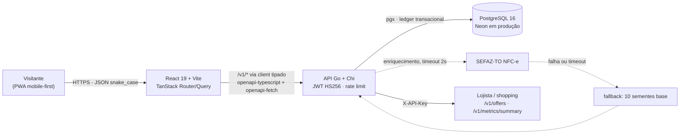

# Raiz

**Quem volta, cria raiz.**

O shopping mede passagens, mas não sabe quem voltou. O **Raiz** usa o QR Code da NFC-e — que já está no cupom do visitante — para criar identidade e recorrência: sementes por cupom, missões entre lojas e recompensa resgatável na mesma visita. Sem instalar app, sem integração com PDV e sem alterar o caixa do lojista.

Desafio 05 do **HackaRun 2026** — UniCatólica · Capim Dourado Shopping, Palmas-TO.

- **Produto no ar:** <https://raiz.marcio.run>
- **API:** <https://raiz-api.marcio.run> · [`/healthz`](https://raiz-api.marcio.run/healthz) · [`/docs`](https://raiz-api.marcio.run/docs) · [`/openapi.yaml`](https://raiz-api.marcio.run/openapi.yaml)

O produto pode ser aberto diretamente nos links acima; este repositório não inclui capturas de tela.

## O que o produto faz

- **Entrada sem senha:** nome e telefone, com OTP. No modo demo o código é fixo `000000`, sinalizado na tela.
- **Cupom por QR ou pelos 44 dígitos:** a chave de acesso da NFC-e é validada localmente (formato e dígito verificador módulo 11). A consulta à SEFAZ é apenas enriquecimento, com timeout de 2s e fallback.
- **Sementes com lastro em ledger:** 10 sementes por cupom + 1 por real gasto quando o total é conhecido. O saldo é sempre a soma de `ledger.delta`.
- **Missões:** 3 lojas diferentes em 7 dias (+150), alimentação + moda na mesma semana (+100) e ritmo de 4 semanas seguidas (+200). Quebrar sequência nunca subtrai sementes.
- **Carteira e extrato:** histórico paginado por cursor, direto do ledger.
- **Prêmios reais:** resgate atômico, estoque controlado e voucher de 6 caracteres válido por 10 minutos no balcão.
- **Ranking da safra:** top 10 da temporada, calculado sobre o ledger.
- **Perfil e LGPD:** consentimento com data, exportação dos dados e exclusão da conta.
- **Desktop:** a partir de 1024px a interface vira sidebar + prévia em moldura de celular, com toggle para alternar para tela cheia. Serve para demonstrar o app numa tela grande sem perder o desenho mobile.
- **Antifraude:** chave única, 1 cupom por loja por dia, teto de 5 cupons por dia e janela de 72h. CNPJ desconhecido pontua 10 sementes e entra em revisão, sem erro na tela.

Fora do MVP (não implementado): crédito automático de indicação (hoje existe só o convite compartilhável no Perfil), WhatsApp, OpenWeather, cashback em reais, app nativo, OCR de cupom e painel administrativo do lojista.

## Rodando localmente

Pré-requisitos: **Go 1.26** (ver `apps/api/go.mod`), **Node.js 20+**, **Docker** com Compose e `make`.

```bash
make up      # PostgreSQL 16 em container (raiz-postgres)
make api     # cria apps/api/.env se faltar, sobe em :8080 e aplica migrações no boot
make seed    # massa de demonstração (idempotente)
```

Em outro terminal:

```bash
cd apps/web
cp .env.example .env    # VITE_API_URL=https://raiz-api.marcio.run; use http://localhost:8080 para a API local
npm install
npm run dev
```

- Front: <http://localhost:5173>
- API: <http://localhost:8080> · documentação interativa em `/docs`
- `make` sem alvo lista todos os comandos (`down`, `logs`, `migrate`, `psql`, `test`, `vet`, `fmt`, `check`, `docs`).

Sem `make`, dentro de `apps/api`: `cp .env.example .env`, `go run ./cmd/api`, `go run ./cmd/seed`, `go run ./cmd/migrate`, `go test ./...`.

Variáveis obrigatórias da API (em `apps/api/.env`, nunca commitar valores reais):

| Variável | Uso |
|---|---|
| `DATABASE_URL` | conexão PostgreSQL |
| `JWT_SECRET` | assinatura HS256 das sessões (mínimo 16 caracteres) |
| `PII_KEY` | chave de 32+ caracteres para hash/criptografia do telefone |
| `DEMO_MODE` | `true` habilita OTP fixo `000000` e rotula os dados como demonstração |
| `ALLOWED_ORIGINS` | origens de CORS (`*` em dev) |
| `PARTNER_API_KEY` | opcional; sem ela, `/v1/offers` e `/v1/metrics/summary` respondem 404 |

Referência completa: [`apps/api/.env.example`](./apps/api/.env.example).

**Para parar:** `make down` encerra o Postgres mantendo os dados; `docker compose down -v` remove também o volume. `Ctrl+C` encerra a API e o Vite.

## Como testar a demo

1. Abra <https://raiz.marcio.run/entrar>, informe nome e telefone e use o OTP de demonstração **`000000`**.
2. Na tela de scan, leia o QR de um cupom NFC-e ou digite os **44 dígitos** da chave de acesso. O seed já cadastra três lojas reais do shopping (Centauro, Leitura e Peg Pag), então um cupom delas pontua como loja parceira.
3. Confira as sementes na tela inicial e o lançamento em **Carteira**.
4. Abra **Missões** e **Prêmios**; resgate um prêmio que caiba no saldo e veja o voucher de 6 caracteres.
5. Repita o mesmo cupom: a API responde `409 already_claimed` sem creditar de novo — a chave é única no banco.
6. Limites a observar: 1 cupom por loja por dia, 5 cupons por dia e emissão há no máximo 72h.
7. Um CNPJ fora das lojas parceiras credita 10 sementes e vai para revisão, sem mensagem de erro na tela.

Os dados do seed (5 lojas parceiras, 1 safra, 3 missões, 4 prêmios, 3 ofertas) são explicitamente rotulados como demonstração na interface.

## Arquitetura



O saldo nunca é uma coluna: é a soma de `ledger.delta`. Resgate e crédito rodam em transação no Postgres, e a unicidade da chave de acesso e do código do voucher é garantida por constraint. A SEFAZ só enriquece o valor do cupom; nenhuma falha externa impede o registro.

## API

Contrato OpenAPI 3.1 em [`docs/openapi.yaml`](./docs/openapi.yaml), servido em `/docs` (Scalar) e `/openapi.yaml`. O frontend consome a API exclusivamente pelo client tipado gerado desse contrato.

| Método | Rota | Uso |
|---|---|---|
| `GET` | `/healthz` | saúde da API e do banco |
| `GET` | `/v1/meta` | versão, ambiente e modo demo |
| `POST` | `/v1/auth/otp` | envia o código de acesso |
| `POST` | `/v1/auth/verify` | valida o OTP e devolve o JWT |
| `GET` `DELETE` | `/v1/me` | perfil e exclusão da conta (LGPD) |
| `GET` | `/v1/me/ledger` | extrato com paginação por cursor |
| `POST` | `/v1/receipts` | registra o cupom (`Idempotency-Key`) |
| `GET` | `/v1/home` | dados da tela inicial em uma chamada |
| `GET` | `/v1/missions` | missões e progresso |
| `GET` | `/v1/leaderboard` | ranking da safra |
| `GET` | `/v1/rewards` | prêmios disponíveis |
| `POST` | `/v1/rewards/{id}/redeem` | resgate atômico e voucher |
| `GET` | `/v1/offers` | ofertas ativas (parceiro, `X-API-Key`) |
| `GET` | `/v1/metrics/summary` | métricas agregadas (parceiro, `X-API-Key`) |

Erros seguem `{ "error": { "code", "message", "details" } }`; o front traduz `error.code` para pt-BR em `messages.ts`. Autenticação de visitante por `Authorization: Bearer <jwt>`; endpoints de parceiro por `X-API-Key` (`PARTNER_API_KEY`).

## Deploy

- **Web:** Cloudflare Workers static assets (`apps/web/wrangler.jsonc`) → `raiz.marcio.run`.
- **API:** Fly.io região `gru`, imagem distroless, segredos via `fly secrets` → `raiz-api.marcio.run`.
- **Banco:** Neon (PostgreSQL 16); migrações aplicadas no boot da API.

Passo a passo, segredos e verificação pública em [`docs/DEPLOY.md`](./docs/DEPLOY.md). Deploy do front: `cd apps/web && npm run deploy`; da API: `fly deploy`.

## Estrutura do repositório

```
.
├── apps/
│   ├── api/                    # Go + Chi, binário único
│   │   ├── cmd/                # api, migrate, seed
│   │   └── internal/
│   │       ├── receipt/        # parser NFC-e (44 dígitos, módulo 11)
│   │       ├── points/         # ledger, missões, ritmo, resgate
│   │       ├── sefaz/          # enriquecimento com timeout e fallback
│   │       ├── httpapi/        # rotas /v1, auth, erros
│   │       ├── config/         # env + validate, falha no boot
│   │       └── database/       # migrações e seed.sql
│   └── web/                    # PWA React 19 + Vite
│       ├── src/routes/         # 7 telas (TanStack Router, file-based)
│       ├── src/features/       # home, scan, wallet, missions, rewards, profile
│       └── src/api/            # client e tipos gerados de docs/openapi.yaml
├── docs/                       # contexto, regras, contrato, design, deploy
├── entregas/                   # documentos da banca (.md + .pdf)
├── docker-compose.yml
├── fly.toml
└── Makefile
```

Telas: `/entrar`, `/` (Início), `/scan`, `/carteira`, `/missoes`, `/premios`, `/perfil` — barra inferior de 4 itens e botão de scan sempre visível.

## Documentação

- [docs/CONTEXTO_PROJETO.md](./docs/CONTEXTO_PROJETO.md) — visão, stack, decisões arquiteturais, estado atual e pendências
- [docs/REGRAS_NEGOCIO.md](./docs/REGRAS_NEGOCIO.md) — entidades, fluxos, validações e regras de domínio
- [docs/openapi.yaml](./docs/openapi.yaml) — contrato HTTP, fonte única do client tipado
- [docs/PRODUCT.md](./docs/PRODUCT.md) — proposta de produto e personas
- [docs/DESIGN.md](./docs/DESIGN.md) — princípios de interface, tom, `<RaizLogo />` e o easter egg do Jason
- [docs/DEPLOY.md](./docs/DEPLOY.md) — deploy da API e do frontend
- [AGENTS.md](./AGENTS.md) — convenções do repositório
- [apps/web/AGENTS.md](./apps/web/AGENTS.md) — organização do frontend

## Entregas

| Entrega | Markdown | PDF |
|---|---|---|
| 1 — Planejamento técnico inicial | [ENTREGA-1.md](./entregas/ENTREGA-1.md) | [ENTREGA-1.pdf](./entregas/ENTREGA-1.pdf) |
| Final — resumo de uma página para os avaliadores | [RESUMO-AVALIADORES.md](./entregas/RESUMO-AVALIADORES.md) | [RESUMO-AVALIADORES.pdf](./entregas/RESUMO-AVALIADORES.pdf) |

Material de apresentação: [roteiro do vídeo de 90s, pitch de 5 min e outline do deck](./entregas/PITCH-E-VIDEO.md) e [composição do vídeo](./entregas/VIDEO-COMPOSICAO.md).

A ENTREGA-1 reúne tese do produto, personas, estrutura das 7 telas, arquitetura, contrato da API, plano de execução, ordem de corte, riscos e LGPD. Este README é o documento de entrega final do MVP.

## Vídeo de apresentação

<!-- TODO: link do YouTube -->

_(link a ser adicionado)_

## Verificação

- `make check` (gofmt + `go vet` + `go test ./...`): passa, todos os pacotes `ok`.
- Frontend (`cd apps/web`): `npm run test` (Vitest) — 18 arquivos, 110 testes, todos passando. `npm run build` roda o typecheck e o build de produção; `npm run api:types` regenera os tipos quando o contrato muda.
- A máquina precisa de Node 22+ (o Vitest usa o `localStorage` do jsdom, restaurado em `src/test/setup.ts`).

## LGPD

Apenas nome e telefone são coletados, com consentimento datado. O telefone é persistido como hash HMAC e versão cifrada (AES-256-GCM); CPF presente em cupom é descartado e nunca armazenado nem logado. O Perfil oferece exportação dos dados e exclusão da conta (`DELETE /v1/me`). Métricas para parceiros são somente agregadas.

## Easter egg

Clicar **13 vezes** na marca **RAIZ** (`<RaizLogo />`) faz as raízes do logotipo crescerem progressivamente ao longo dos 12 primeiros cliques e abre, no 13º, o modal de **Sexta-feira 13** do Jason (*"Sexta-feira 13 no Capim."* / *"Você cutucou a raiz 13 vezes."*), que fecha automaticamente após 3 segundos (ou via **Fechar** / `Esc` / clique fora). É puramente cosmético no cliente (`apps/web/src/components/raiz-logo.tsx` e `jason-scare-dialog.tsx`), sem impacto em sementes, missões ou API.
